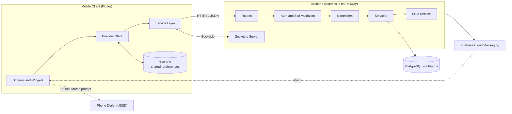
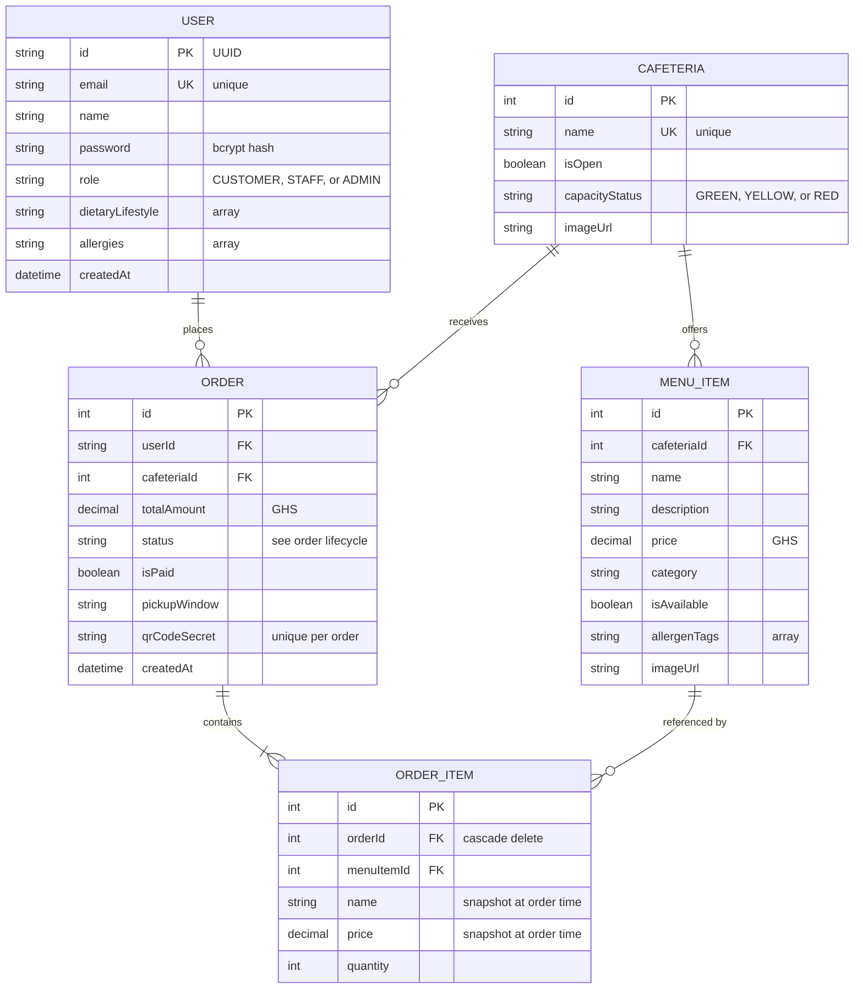
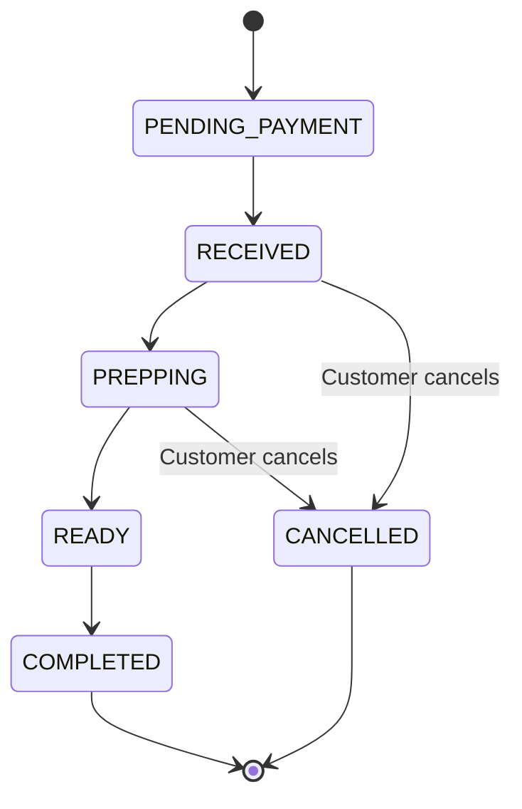
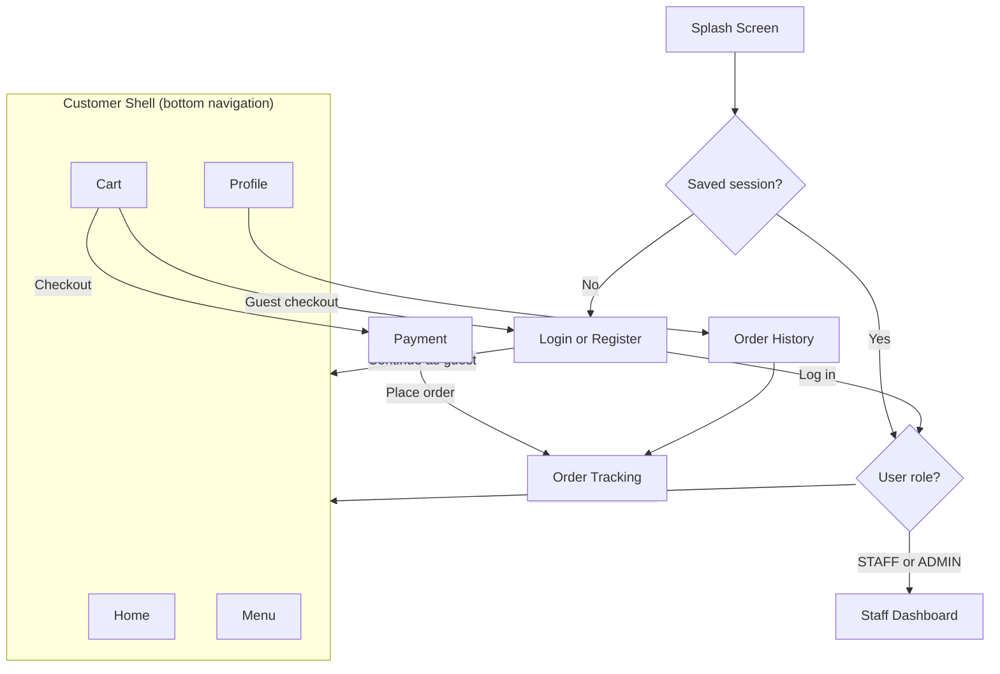
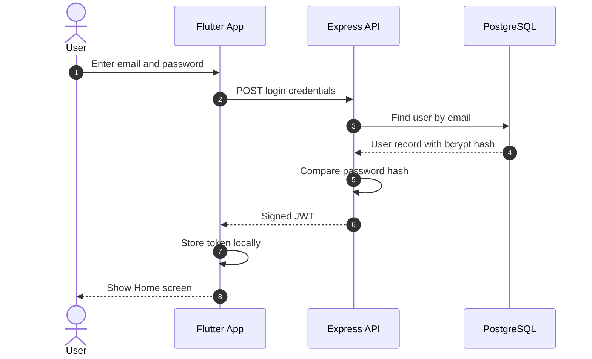
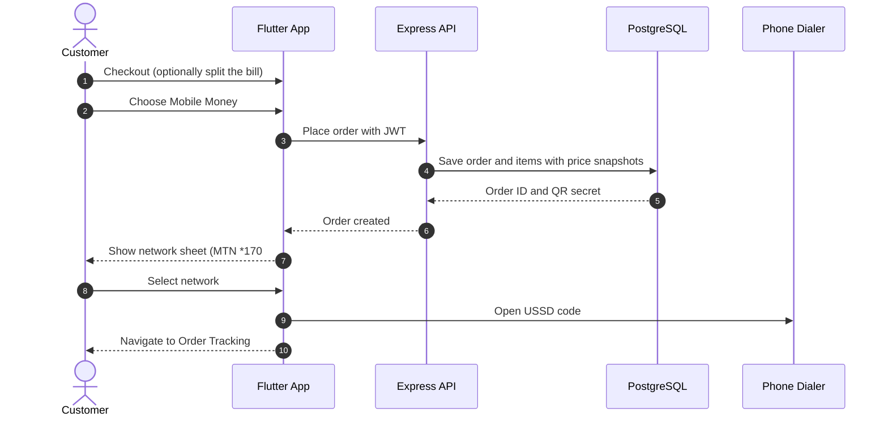
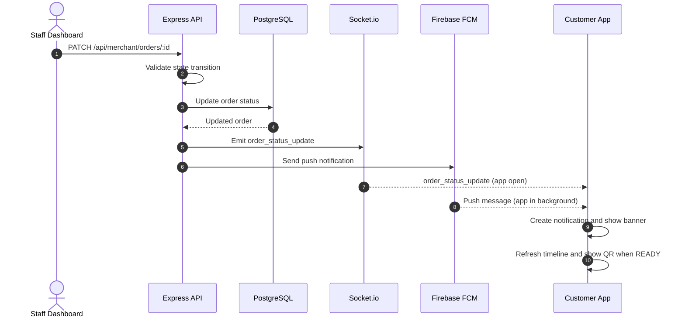

# Qwik: Ashesi Campus Food Pre-Ordering

Qwik is a mobile-first food pre-ordering system for Ashesi University. Students and staff can browse cafeteria menus, place orders in advance, pay through Mobile Money or a meal plan, and track each order in real time. Cafeteria staff manage their queues, menus, and capacity from a dashboard in the same app.

The project has two parts:

- **`backend/`**: a TypeScript REST and WebSocket API built with Express.js, Prisma, and PostgreSQL, deployed on Railway.
- **`mobile_app/`**: a Flutter client for Android, iOS.

---

## Table of Contents

1. [Features](#1-features)
2. [System Architecture](#2-system-architecture)
3. [Technology Stack](#3-technology-stack)
4. [Repository Structure](#4-repository-structure)
5. [Data Model](#5-data-model)
6. [Order Lifecycle](#6-order-lifecycle)
7. [Backend](#7-backend)
8. [Mobile Application](#8-mobile-application)
9. [Key Flows](#9-key-flows)
10. [Getting Started](#10-getting-started)
11. [Configuration](#11-configuration)
12. [Testing](#12-testing)
13. [Deployment](#13-deployment)
14. [Roadmap](#14-roadmap)
15. [Team](#15-team)

---

## 1. Features

### Customers

| Area | What it does |
|---|---|
| Accounts | Register, log in, browse as a guest, and use biometric unlock (fingerprint or face). |
| Browsing | See all cafeterias, search across menus, and view today's specials. |
| Food safety | Read ingredient lists, see allergen tags, and hide items that contain the user's saved allergens. |
| Dietary filters | Filter by Vegan, Keto, and show only Express Meals (quick-prep items). |
| Cart | Adjust quantities, get a cafeteria conflict warning, and split the bill among 2 to 20 people. |
| Payment | Pay by Mobile Money (MTN, Telecel, AirtelTigo), at the meal plan counter, or in cash on pickup. |
| Tracking | Follow live status updates, see a QR code when the order is ready, and cancel while it is still being received or prepared. |
| Notifications | Receive in-app notifications, device banners, and push notifications, with read and unread states. |
| History | View past orders and open any of them to see their details. |

### Cafeteria staff

| Area | What it does |
|---|---|
| Order queue | View active orders and advance each one through the preparation pipeline. |
| Menu management | Add, edit, and delete menu items, and toggle their availability. |
| Capacity | Set each cafeteria's congestion level (Green, Yellow, or Red). |
| Specials | Create, edit, and delete daily promotions. |

### Business rules

- **Staff discount:** users with the `STAFF` role receive an automatic 20% discount.
- **Order state machine:** the server rejects invalid status changes. For example, an order cannot move from `READY` back to `PENDING_PAYMENT`.
- **Pricing:** the cart adds 4.4% tax and a flat ₵6.00 delivery charge. All amounts are in Ghana cedis (GHS, ₵).
- **Price snapshots:** each order item stores the name and price at the time of purchase, so later menu changes do not alter past orders.

---

## 2. System Architecture



**How the pieces fit together**

- **REST API** handles authentication, menus, orders, and merchant operations.
- **Socket.io** pushes live changes (order status, cafeteria congestion, inventory) to connected clients without polling.
- **Firebase Cloud Messaging** delivers notifications when the app is in the background or closed.
- **Offline cache** stores cafeterias and recent data on the device, so the app still shows content when the network is weak.

---

## 3. Technology Stack

### Backend

| Component | Technology |
|----|----|
| Language | TypeScript |
| Framework | Express.js 5.2.1 |
| Database | PostgreSQL |
| ORM | Prisma 7.5.0 |
| Real-time | Socket.io 4.8.3 |
| Validation | Zod 4.3.6 |
| Security | Helmet, bcrypt, JWT |
| File uploads | Multer 2.1.1 |
| Logging | Morgan |
| Testing | Vitest, Supertest |
| Hosting | Railway (Dockerfile, Procfile, nixpacks.toml) |

### Mobile app

| Component | Technology |
|----|----|
| Language | Dart |
| Framework | Flutter |
| State management | Provider (`ChangeNotifier`) |
| Local storage | shared_preferences, Hive |
| HTTP client | `http` package |
| Real-time | `socket_io_client` |
| Push notifications | Firebase Cloud Messaging |
| Local notifications | flutter_local_notifications |
| QR codes | qr_flutter |
| Biometrics | local_auth |
| Dialer launch | url_launcher |
| Target platforms | Android, iOS, macOS |

---

## 5. Data Model

### Entity relationships



### Model notes

- **User:** `id` is a UUID. The `role` field controls access to the staff dashboard and the staff discount.
- **Cafeteria:** `capacityStatus` drives the congestion indicator that customers see before choosing where to eat.
- **MenuItem:** `isAvailable` lets staff hide items without deleting them. `allergenTags` powers the allergen warnings and the "Hide Allergens" filter.
- **Order:** `qrCodeSecret` is unique per order and is encoded in the QR code shown at pickup. `pickupWindow` stores the time the customer requested.
- **OrderItem:** `name` and `price` are copied from the menu at checkout and never change afterwards. Deleting an order removes its items.

The Prisma schema also includes a `Special` model for daily promotions. See `prisma/schema.prisma` for its full definition.

---

## 6. Order Lifecycle



| Status | Meaning | Who moves it forward |
|---|---|---|
| `PENDING_PAYMENT` | Order created, payment not yet confirmed | Customer (payment) |
| `RECEIVED` | Order accepted by the cafeteria | Staff |
| `PREPPING` | Food is being prepared | Staff |
| `READY` | Ready for pickup. The QR code appears for the customer. | Staff |
| `COMPLETED` | Customer collected the order | Staff |
| `CANCELLED` | Order cancelled before pickup | Customer, while `RECEIVED` or `PREPPING` |

The server enforces these transitions. Any request that skips a step or moves backwards is rejected.

---

## 7. Backend

### Architecture

Each request follows the same path:

```
Route  →  Middleware (JWT auth, Zod validation)  →  Controller  →  Service  →  Prisma  →  PostgreSQL
```

- **Routes** map URLs to controllers.
- **Middleware** checks the JWT and validates the request body against a Zod schema before any business logic runs.
- **Controllers** handle the HTTP request and response.
- **Services** contain the business logic: discounts, state transitions, notifications, and database access.

### Main endpoints

| Method | Route | Purpose |
|---|----|----|
| GET | `/health` | Health check for uptime monitoring |
| PATCH | `/api/merchant/status` | Set a cafeteria's congestion level |
| PUT | `/api/merchant/inventory` | Toggle menu item availability |
| GET | `/api/merchant/orders/:cafeteriaId` | Load a cafeteria's active order queue |
| PATCH | `/api/merchant/orders/:id` | Advance an order to its next status |

Routes for authentication, cafeterias, orders, users, and specials are defined in `src/routes/`. Each file corresponds to one controller.

### Real-time events (Socket.io)

| Event | Direction | Purpose |
|---|---|----|
| `join_cafeteria` | Client → Server | Subscribe to one cafeteria's updates |
| `status_changed` | Server → Client | Congestion level changed |
| `inventory_updated` | Server → Client | Menu item availability changed |
| `order_status_update` | Server → Client | Order moved to its next stage |

### Validation

Every request body is checked against a Zod schema before reaching a controller. Schemas cover:

- Login and registration
- Cafeteria operations
- Merchant actions
- Order creation and updates
- Payment webhook data

Invalid requests return an error without touching the database.

---

## 8. Mobile Application

### Design system

| Token | Hex | Usage |
|---|---|----|
| Background | `#F2EDE8` | App background (cream) |
| Rust | `#B85C38` | Primary buttons |
| Dark Brown | `#2C1A0E` | Text and headings |
| Orange | `#F5A623` | Highlights and accents |
| Subtext | `#9E9E9E` | Secondary text |

### Screens

| Screen | Purpose |
|--|----|
| Splash | Branded loading screen with optional biometric unlock |
| Login and Register | Email and password sign-in, or account creation. Guests can skip this. |
| Forgot Password | Password reset |
| Home | Greeting, notification bell, today's specials, search, cafeteria list, recommended items |
| Food Detail (sheet) | Ingredients, allergen tags, dietary labels, Express badge, add to cart |
| Menu (Cafeteria) | Browse a cafeteria's menu, search, filter, and hide allergens |
| Cart | Quantities, order summary, bill splitting, checkout |
| Payment | Choose Mobile Money, meal plan, or cash on pickup |
| Order Tracking | Live timeline, QR code at `READY`, item breakdown, cancel and refresh |
| Notifications | Notification list with read state |
| Order History | Past orders with status, total, and date |
| Profile | Edit name, view recent orders, set dietary preferences and allergies, log out |
| Staff Dashboard | Order queue, menu management, capacity, and specials (staff and admin only) |

### Navigation



### State and caching

- **Provider** holds app-wide state such as the user session, cart, and notifications.
- **Cart service** is a singleton. It enforces the rule that all items come from one cafeteria.
- **Hive** caches cafeterias and menus, so screens load quickly and still work when the network is unreliable.
- **shared_preferences** stores lightweight settings such as the session token and biometric preference.
- **SocketService** keeps the order timeline and cafeteria status in sync while the app is open.
- **FcmService** and **NotificationService** handle push messages and show device banners.

---

## 9. Key Flows

### 9.1 Login



### 9.2 Placing an order with Mobile Money



The app opens the USSD prompt for the customer's network. Automated confirmation through the MoMo API is planned (see [Roadmap](#14-roadmap)).

### 9.3 Live order update



---

## 10. Getting Started

### Prerequisites

| Tool | Version | Used for |
|---|---|---|
| Node.js | 24 or later (LTS recommended) | Backend |
| npm | Ships with Node.js | Backend packages |
| PostgreSQL | 17 or later | Database |
| Flutter SDK | Current stable | Mobile app |
| Xcode | Latest (macOS only) | iOS and macOS builds |
| Android Studio | Latest | Android builds |
| Firebase project | Configured | Push notifications |

### 10.1 Backend setup

```bash
cd backend

# 1. Install dependencies
npm install

# 2. Create a .env file (see Configuration below)

# 3. Apply database migrations
npx prisma migrate dev

# 4. Load sample data (cafeterias, menus, and test accounts)
npx prisma db seed

# 5. Start the development server
npm run dev
```

Confirm the server is running:

```bash
curl http://localhost:<PORT>/health
```

### 10.2 Mobile app setup

```bash
cd mobile_app

# 1. Install Flutter packages
flutter pub get

# 2. Point the app at your backend
#    Set the base URL in lib/services/api_service.dart and
#    lib/services/socket_service.dart to your local or Railway address.

# 3. Run on a connected device or emulator
flutter run
```

**Firebase:** place `google-services.json` in `mobile_app/android/app/` and the iOS configuration in `mobile_app/ios/Runner/`. The Dart options file `lib/firebase_options.dart` is already generated. To regenerate it, run `flutterfire configure`.

---

## 11. Configuration

Create `backend/.env` with the values below. Variable names are indicative. Check `backend/env.ts` for the exact names the code reads.

| Variable | Required | Description |
|---|---|----|
| `DATABASE_URL` | Yes | PostgreSQL connection string |
| `JWT_SECRET` | Yes | Secret used to sign authentication tokens |
| `PORT` | No | HTTP port (defaults to a platform value on Railway) |
| `FIREBASE_*` | For push notifications | Firebase Admin credentials |
| `SMTP_*` | For email features | Mail server settings used by `email.service.ts` |

Never commit `.env` files or service account keys to version control.

---

## 12. Testing

### Backend

```bash
cd backend
npm test            # Runs Vitest suites
```

| Suite | Location | Covers |
|---|---|---|
| Unit | `tests/unit/` | Merchant service logic |
| Integration | `tests/integration/` | Merchant API endpoints against a test database |
| Setup | `tests/setup/` | Global setup and teardown |

### Mobile app

```bash
cd mobile_app
flutter test
```

---

## 13. Deployment
| **For authorised personnels only**

The backend is deployed on **Railway**. The repository includes the configuration Railway needs:

- `Dockerfile` for container builds
- `nixpacks.toml` and `Procfile` for buildpack-based builds
- `railway.json` for service settings

To deploy, connect the `backend/` directory to a Railway service, add the environment variables from [Configuration](#11-configuration), and run `prisma migrate deploy` as part of the release step.

The mobile app is distributed through standard channels: Android APK or App Bundle, iOS through TestFlight or the App Store, and macOS as a desktop build.

---

## 14. Roadmap

### Completed

- Accounts, guest browsing, and biometric unlock
- Menu browsing, search, dietary filters, and allergen controls
- Cart with bill splitting and cafeteria conflict detection
- Mobile Money, meal plan, and cash on pickup payment options
- Live order tracking with Socket.io and QR pickup
- Push notifications and in-app notification list
- Staff dashboard for queues, menus, capacity, and specials

### Planned

| Feature | Description |
|---|---|
| MoMo API integration | Automatic payment confirmation instead of the manual dialer step |
| Group order invites | Share a link so friends can add items from their own devices |
| Menu image uploads | Upload food photos directly from the staff dashboard |
| Ratings and reviews | Rate food items and cafeterias after pickup |
| Reorder | One-tap reorder from past orders |
| Merchant analytics | Sales, popular items, peak hours, and revenue reports |
| Dietary recommendations | Meal suggestions based on preferences and order history |
| Multi-language support | French and local language support |

---

## 15. Team

- Vanessa Logan Berinyuy Anabi
- Welile Ndabenhle Dlamini
- Edem Korbla Anagbah
- Daniel Kwasi Kpatamia

*Built with Flutter, Express.js, PostgreSQL, Prisma, Socket.io, and Firebase.*

---